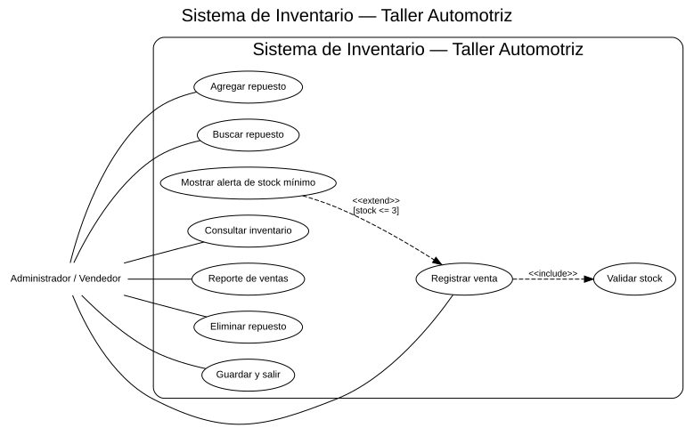
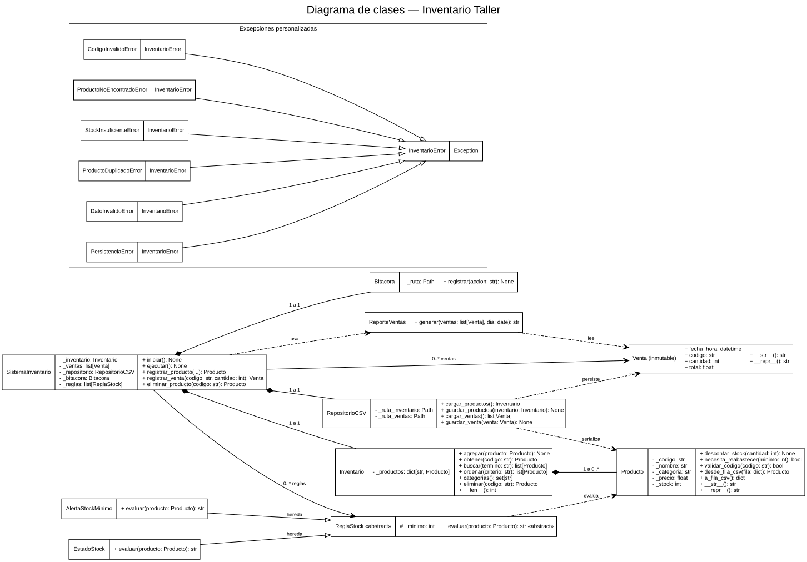

# Sistema de Inventario y Ventas — Taller Automotriz

**Estudiante:** williams Alexander chali gaitan   
**Carné:** 7691-26-14871  
**Curso:** Algoritmos — UMG | **Ciclo:** 2-2026

## Descripción
Refactorización del Proyecto 1 conservando inventario, búsquedas, ventas, ordenamiento por nombre o precio, reportes, CSV, bitácora y eliminación de repuestos. El negocio es un **taller automotriz** y la regla asignada es **alerta de stock mínimo de 3 unidades**: después de vender, si quedan tres o menos, aparece una alerta.

## Ejecución
Con Python 3.10 o superior, abre una terminal en la carpeta raíz y ejecuta:

```bash
python main.py
```

No requiere bibliotecas externas. Los archivos se guardan en `datos/`. El reporte consulta las ventas del día registradas en `datos/ventas.csv`. Para ejecutar pruebas:

```bash
python -m unittest discover -s tests -v
```

## Estructura y clases
- `main.py`: punto de entrada.
- `inventario/modelos.py`: `Producto` valida sus atributos y administra stock; `Venta` guarda los datos de manera inmutable.
- `inventario/inventario.py`: `Inventario` mantiene el diccionario por código, búsquedas, categorías y ordenamiento.
- `inventario/reglas.py`: `ReglaStock` es abstracta; `AlertaStockMinimo` y `EstadoStock` usan el método polimórfico `evaluar()`.
- `inventario/persistencia.py`: `RepositorioCSV` lee/escribe inventario y ventas; `Bitacora` añade eventos.
- `inventario/reportes.py`: `ReporteVentas` forma la tabla de ventas por fecha.
- `inventario/excepciones.py`: excepciones específicas para errores esperados.
- `inventario/app.py`: `SistemaInventario` coordina acciones, menú y errores.
- `docs/`: diagramas editables y reflexión.
- `evidencias/`: guía de capturas de cuatro pruebas (las capturas reales se hacen en tu computadora).
- `proyecto1_original/`: copia original para preparar el primer commit.

## Diagramas UML

### Casos de uso


### Clases


## Ejemplo de uso

```text
3. Registrar venta
Código del repuesto a vender: REP004
Cantidad (disponibles: 2): 1
>> Venta completada. Total: Q45.00
>> ALERTA DE STOCK: Liquido De Frenos Dot4 tiene 1 unidades restantes.
```

## Reflexión
[Leer reflexión](docs/reflexion.md).

