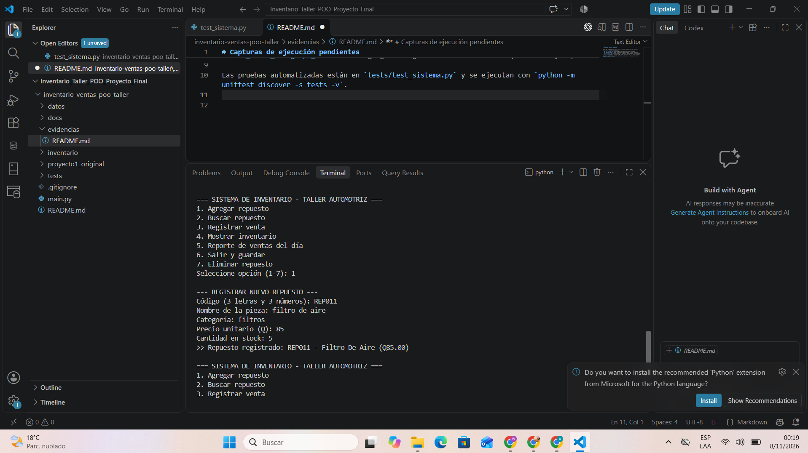
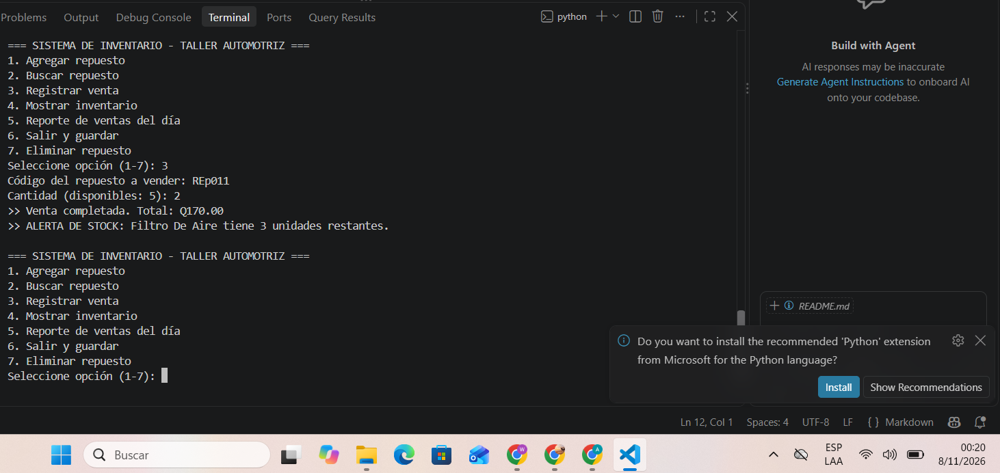
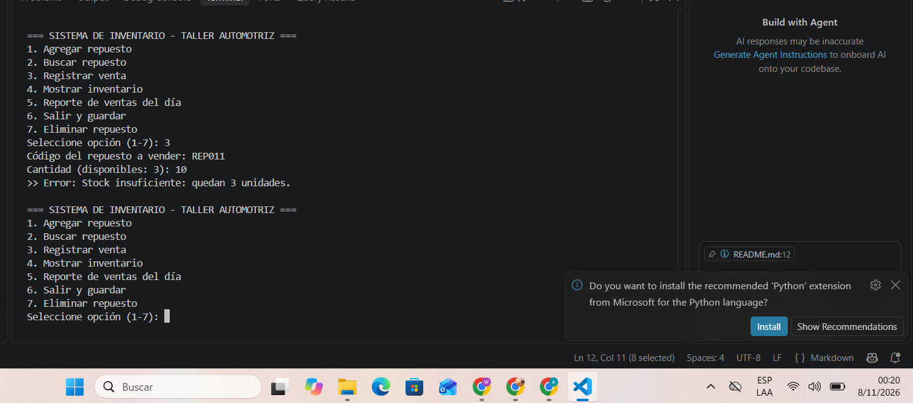
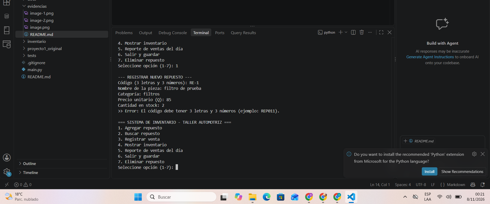

# Capturas de ejecución pendientes

Guarda aquí **capturas auténticas** de tu terminal con fecha y resultados visibles. Necesitas por lo menos cuatro pruebas:

1. `01_alta_busqueda.png`: agregar REP011 y encontrarlo por parte del nombre.
2. `02_venta_alerta.png`: vender unidades hasta dejar 3 o menos y mostrar la alerta.
3. `03_error_stock.png`: intentar vender más unidades de las disponibles (error manejado).
4. `04_error_codigo.png`: intentar agregar código incorrecto como RE-1 (error manejado).

Las pruebas automatizadas están en `tests/test_sistema.py` y se ejecutan con `python -m unittest discover -s tests -v`.

